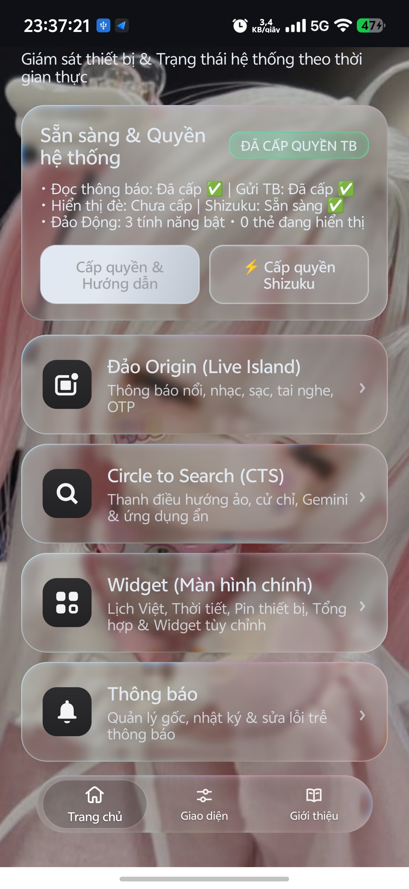
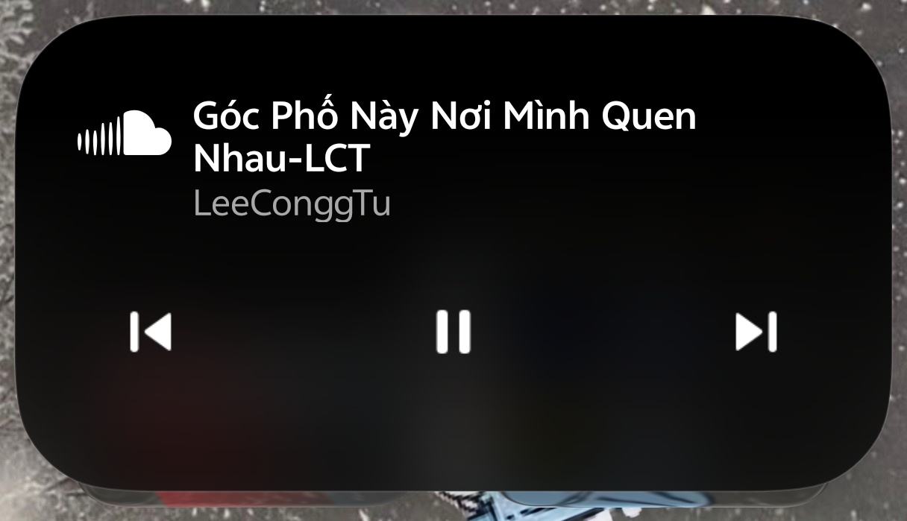
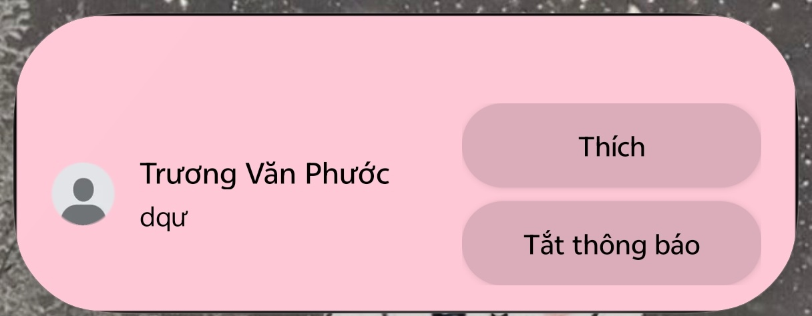
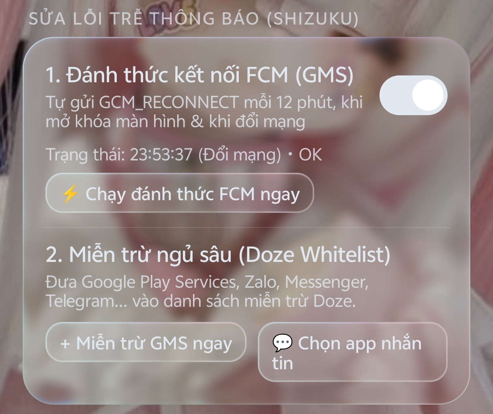
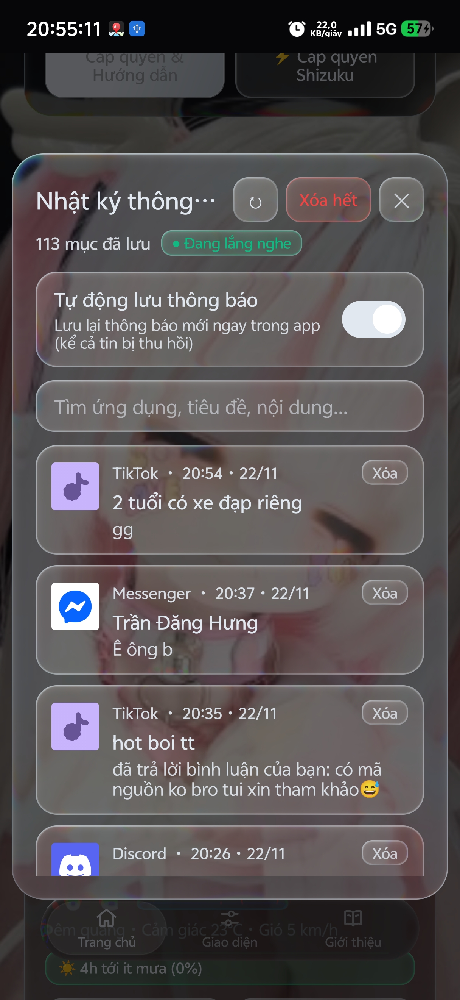
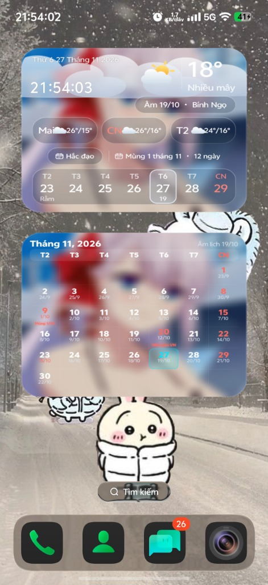

  
  <h1>Origin Tool</h1>
  
<b>Bộ công cụ nâng cấp trải nghiệm hằng ngày trên OriginOS (vivo / iQOO)</b>

  
Gọi nhanh Gemini &amp; Circle to Search thay cho BlueAI, làm đẹp và cá nhân hóa Origin Island, thêm Widget kính mờ Lịch Việt và khắc phục trễ thông báo trên ROM nội địa.

  

    <a href="https://github.com/vphuoc13/OriginIsland/releases/latest"><b>Tải bản mới nhất (Releases)</b></a>
  

---

## Điểm nổi bật trên phiên bản mới

### 1. Giao diện Liquid Glass mới — Gọn và mượt hơn
Trung tâm điều khiển trong suốt mới gom toàn bộ tính năng chính vào một màn hình trực quan, dễ bấm và dễ nhìn ngay khi mở app.

  

---

### 2. Chặn BlueAI — Mở Circle to Search & Gemini tức thì
Không cần thao tác rườm rà với trợ lý mặc định của máy nữa:
- **Ấn giữ nút nguồn 0,5s:** Gọi ngay **Circle to Search** hoặc **Gemini** nổi trên màn hình — **không cần Shizuku**.
- **Ấn giữ thanh điều hướng:** Hỗ trợ gọi nhanh tương tự và chặn triệt để BlueAI khi dùng kèm Shizuku.

---

### 3. Origin Island (Đảo động) thông minh hơn
- **Cuộc gọi & tin nhắn tự mở rộng:** Cuộc gọi đến (Zalo, Messenger…) và tin nhắn mới tự bung rộng gọn gàng ngay trên đảo để xem và trả lời nhanh.
- **Đảo phát nhạc thu gọn & mở rộng:** Theo dõi sóng nhạc dạng viên thuốc nhỏ hoặc chạm để bung trình điều khiển nhạc ngay trên đảo.
- **Tự chỉnh màu Đảo theo sở thích:** Chọn bất kỳ tông màu nào bạn thích, áp dụng đồng bộ cho cả đảo tin nhắn lẫn các thẻ chức năng khác như đo công suất sạc, đảo tùy chỉnh…
- **Chống làm phiền & gom tin gọn:** Gom tin nhắn cùng người gửi trong 60 giây, tránh đảo bật đi bật lại nhiều lần, tùy chọn tắt đảo khi bật Không làm phiền, hiện thời gian gọi và chỉnh cách hiển thị nội dung trên đảo.

  
  &nbsp;&nbsp;
  

  

---

### 4. Fix trễ thông báo & xem lại nhật ký tin nhắn
- **Fix thông báo trên ROM nội địa:** Đánh thức kết nối FCM và giữ app chạy nền ổn định qua Shizuku để tin nhắn tới đúng lúc, hạn chế tình trạng mở máy mới nổ thông báo (ổn định trên hầu hết ứng dụng).
- **Nhật ký thông báo của OriginOS:** Mở nhanh nhật ký thông báo có sẵn trên hệ thống mà không cần cấp thêm quyền.
- **Nhật ký thông báo ngay trong app:** Lưu lại lên tới **200 thông báo & nội dung tin nhắn** ngay bên trong Origin Tool để bạn dễ tìm và xem lại khi lỡ vuốt mất.

  
  &nbsp;&nbsp;
  

---

### 5. Bộ Widget kính mờ tùy biến
Thêm ra màn hình chính bộ Widget kính mờ đồng bộ màu nền với nhiều thông tin hữu ích cho người dùng Việt:
- **Lịch tuần & Lịch tháng** kèm âm dương, ngày hoàng đạo / hắc đạo, lễ Tết.
- **Đồng hồ, thời tiết hiện tại & dự báo 3 ngày**, trạng thái pin thiết bị và Widget tùy biến.

  

---

### 6. Một số tiện ích nhỏ hữu ích khác
- Chống lặp mở to đảo khi có tin nhắn đến liên tiếp.
- Tự ẩn Origin Tool khỏi màn hình đa nhiệm cho gọn máy.
- Tinh chỉnh giao diện, bổ sung thêm tùy chọn cho Circle to Search, hiện thời gian gọi và cách hiển thị thông tin trên đảo tin nhắn.

---

## Cài đặt & Cập nhật
1. Tải file `.apk` mới nhất tại trang **[Releases](https://github.com/vphuoc13/OriginIsland/releases/latest)** và cài đặt như bình thường.
2. Khi có phiên bản mới, chỉ cần mở app → vào tab **Giới thiệu** → bấm **Kiểm tra cập nhật** để app tự tải về và cài đè.
